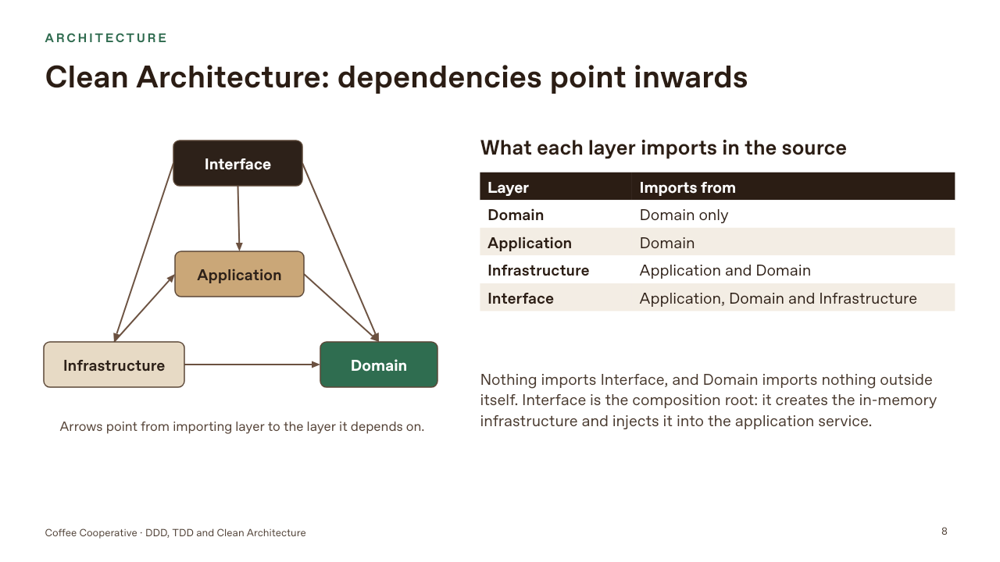

# Coffee Cooperative Delivery and Farmer Payout

A small four-member DDD, TDD and Clean Architecture project for the Advanced Programming group coursework, Department of Computer Science, Makerere University (instructor: Lwoma Joseph).

A farmers' coffee cooperative records each delivery's bags, grades the delivery against a moisture standard, works out the payout from the day's price, and credits the farmer's account exactly once. Two use cases are connected by one domain event:

1. **Grade Delivery** (main use case, `GradeDeliveryService`)
2. **Credit Farmer Account** (follow-up, `CreditFarmerOnDeliveryGraded`, triggered by `DeliveryGraded`)

Persistence is in memory. Withdrawals, mobile-money payouts, export sales, user login, a web interface, a production database and deployment are out of scope.

## Team

| Member | Registration number | Role | Slides |
|---|---|---|---|
| SEMPALA HILLARY GODWIN | 24/U/24722/PS | Domain Lead | 1, 2, 3, 15 |
| CHELIMO EMMANUEL | 24/U/14938/PSA | Domain Model Lead | 4, 5, 6, 10 |
| AGABA JOEL MUHANGUZI | 24/U/23686/PS | Architecture Lead | 7, 8, 9, 14 |
| KASIBANTE ENOCK JAMES | 24/U/15602/PSA | Testing Lead | 11, 12, 13 |

All four members share Integration Lead responsibilities.

## Run

Requires Python 3.10 or later. Run every command from the project root (the folder containing this README). On Windows, `py` works in place of `python`.

```
python -m unittest discover -v
python -m interface.main
```

`python -m interface.main --demo` runs a fixed scenario instead of the menu. It produced `evidence/demo_run.txt`.

## Console usage

The menu starts with sample data:

| Data | Value |
|---|---|
| Farmers | F001 Nakato Sarah (Active), F002 Okello James (Suspended) |
| Deliveries | D001 for F001 and D002 for F002, each 98.5 kg of Robusta (bags of 50 kg and 48.5 kg) |
| Prices | Robusta at UGX 12,000 per kg; no Arabica price, so grading Arabica shows BR4 |

Option 1 (Grade a delivery) is the main use case and goes through `GradeDeliveryService`. Options 2 to 6 are a test harness for setting up data. They call the aggregates directly, and the aggregates still enforce their own rules. Option 7 lists everything stored.

| Try | Enter | Expected |
|---|---|---|
| BR1 | 1, D001, 13.5 | Rejected, outside 8.0% to 13.0% |
| BR1 boundary | 1, D001, 13.0 | Graded, F001 credited UGX 1,182,000 |
| BR2 | Grade D001 again | Rejected, already graded |
| BR3 | 3, any delivery, a 70 kg bag or a repeated bag number | Rejected |
| BR4 | 2 to record an Arabica delivery, 3 to add a bag, then 1 to grade it | Rejected, no price; set one with 6 and it grades |
| BR5 | 1, D002, 12.5 | Graded but not credited, F002 is suspended |
| BR6 | 1, D999 | NotFound |

## Six business rules

| Rule | Statement | Responsible code | Violation outcome | Test |
|---|---|---|---|---|
| BR1 Value | A moisture reading must be between 8.0% and 13.0% inclusive | `domain/moisture_reading.py` `MoistureReading` | `InvalidMoistureReading`; delivery not graded | T1 |
| BR2 Identity/state | A delivery moves from Received to Graded; a graded delivery cannot be graded again or take more bags | `domain/delivery.py` `Delivery` | `DeliveryAlreadyGraded`; state unchanged | T2 |
| BR3 Invariant | A received delivery holds 0 to 10 bags with unique numbers, each with finite weight over 0 kg and at most 60 kg; grading requires at least one bag | `domain/delivery.py` `Delivery`, `Bag`; `domain/weight.py` `Weight` | `BagLimitExceeded`, `DuplicateBag`, `InvalidWeight` or `EmptyDelivery` | T3 |
| BR4 Cross-concept | Payout = total net kg × the price per kg for that variety on the delivery date | `domain/payout_calculator.py` `PayoutCalculator` | `PriceNotAvailable`; delivery not graded | T4 |
| BR5 Follow-up | Grading requests a payout credit via DeliveryGraded; the account accepts only if active and the delivery has not already been credited | `domain/events.py` `DeliveryGraded`; `application/credit_farmer_handler.py`; `domain/farmer_account.py` | `FarmerAccount` refuses; reason returned; delivery remains graded | T5, T7, T8 |
| BR6 Lookup | A delivery can only be graded if it and its farmer already exist | `application/grade_delivery_service.py` with both repositories | Status `NotFound`; nothing saved | T6 |

The six numbered rules use labelled rejection messages where applicable. Supporting Money validation has its own messages.

## Domain model

| Building block | Where | Notes |
|---|---|---|
| Value objects | `MoistureReading`, `Weight`, `Money` | Immutable and compared by value; `MoistureReading` enforces BR1 |
| Entities | `Delivery` (delivery ID), `FarmerAccount` (farmer ID), `Bag` (bag number within its delivery) | Identity matters; state changes over time |
| Aggregate A | `Delivery` with `Bag` children | Protects BR2 and BR3 |
| Aggregate B | `FarmerAccount` | Accepts a credit only when Active and only once per delivery |
| Domain service | `PayoutCalculator` | BR4 needs both the delivery and the price board |
| Domain event | `DeliveryGraded` | Requests the follow-up credit in Aggregate B |
| Repositories | `DeliveryRepository`, `FarmerAccountRepository` | Abstractions in `application/`, in-memory versions in `infrastructure/` |
| Factory | Not used | Creating a delivery has no rules of its own |
| Layer supertype | `domain/aggregate_root.py` `AggregateRoot` | Shared event recording for both roots |

## Architecture and event flow



Arrows point from each importing layer to the layer it depends on. The domain has no dependency on the other layers.

```
domain/          value objects, entities, aggregates, domain service, event, errors
application/     GradeDeliveryService, DTOs, repository abstractions, event dispatcher, handler
infrastructure/  in-memory repositories and price board
interface/       main.py (composition root and console)
tests/           T1 to T8
evidence/        TDD runs, full test run, demo output
```

| Layer | Imports from |
|---|---|
| Domain | Domain only |
| Application | Domain |
| Infrastructure | Application and Domain |
| Interface | Application, Domain and Infrastructure |

Request → `GradeDeliveryService` → `Delivery.grade()` → `DeliveryGraded` → `CreditFarmerOnDeliveryGraded` → `FarmerAccount.credit()`

The service builds the `MoistureReading`, asks `PayoutCalculator` for the payout, and tells the delivery to grade itself. The delivery records `DeliveryGraded`. After saving, the service passes the event to an in-process dispatcher, which calls the handler. The handler loads the farmer's account and asks it to accept the credit. Delivery never imports or changes `FarmerAccount`.

## Eight tests

| Test | Rule | Checks | Kind |
|---|---|---|---|
| T1 | BR1 | Both boundaries accepted; values outside and NaN rejected | Boundary, rejection |
| T2 | BR2 | Regrading, adding bags after grading and public state/identity writes refused | Rejection |
| T3 | BR3 | Bag limit, duplicate number, immutable bag, invalid weight and empty grading | Rejection |
| T4 | BR4 | Correct payout; correct delivery-date price; unavailable variety/date rejected | Calculation |
| T5 | BR5 | Grading records one `DeliveryGraded` with the right farmer and payout | Event |
| T6 | BR6 | Unknown delivery or farmer returns `NotFound` and nothing changes | Rejection |
| T7 | Use case | Active farmer: delivery graded, event handled, balance increased; replayed event refused | Success, rejection |
| T8 | Use case | Suspended farmer: delivery graded, balance unchanged, reason returned | Aggregate B rejects |

## Evidence

| File | Contents |
|---|---|
| `evidence/tdd_1_failing_run.txt` | Historical pytest collection failure: missing errors module |
| `evidence/tdd_2_failing_run_stub.txt` | Bare `MoistureReading` with no check; fails because 13.1% is accepted (used on Slide 12) |
| `evidence/tdd_3_passing_run.txt` | Range check added; T1 passes |
| `evidence/tdd_reproduced_red.txt` | Revised T1 run in an isolated copy with validation disabled; fails |
| `evidence/tdd_reproduced_green.txt` | Same revised T1 against final implementation; passes |
| `evidence/full_test_run.txt` | Final run of all eight tests |
| `evidence/demo_run.txt` | Output of `python -m interface.main --demo` |

The three original pytest TDD files predate the folder reorganisation. The final eight tests use Python's built-in unittest framework, with expanded coverage. The original logs are retained as historical evidence, not claimed as a run of the revised project. The current final test output is in full_test_run.txt.

The reproduced RED/GREEN sequence is a verification of the TDD example, not a claim that the revised tests were historically written first. RED temporarily replaced the body of MoistureReading.__post_init__ with pass in an isolated copy; GREEN ran the same test against the unchanged final implementation.

The project deliberately keeps a graded delivery when a suspended account refuses credit. Recovery or retry of rejected credits is outside scope. The price board is editable reference data, and Bag objects and public aggregate state are protected against accidental changes.

## AI use

Claude (Anthropic) assisted with the initial design, implementation, tests and documentation. ChatGPT assisted with the final audit, encapsulation fixes, test coverage, documentation and slide corrections. The group is responsible for reviewing and explaining the work.
